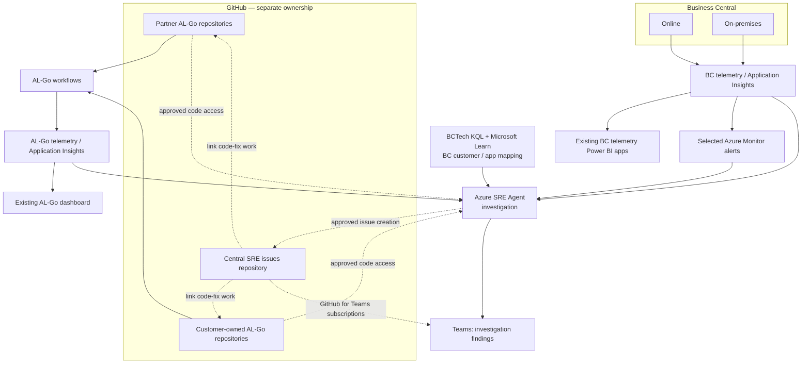

*We have the pipelines, the telemetry and the source code. Why is connecting them still such a manual job?*

Imagine an AL-Go deployment finishes successfully. Green checkmark, everything looks fine. Shortly afterwards, one customer's production environment starts producing a lot more AL error dialogs than usual.

Was that deployment responsible? And which extension, repository and change should I look at first?

I can investigate all of this today. But I'd probably have Application Insights, GitHub and a couple of browser tabs open before I even get started.

**That is the part I'd like to improve.**

<!--more-->

## AL-Go already knows quite a lot

I'm a fan of [AL-Go for GitHub](https://github.com/microsoft/AL-Go). It gives us a solid CI/CD foundation for AL extensions without everybody maintaining their own GitHub Actions framework.

One feature that deserves more attention is **AL-Go's own telemetry**. Configure `PartnerTelemetryConnectionString`, and AL-Go can send workflow and action events to Application Insights, including repository information, run IDs, branches and outcomes.

Microsoft even provides an [AL-Go telemetry dashboard for Azure Data Explorer](https://github.com/microsoft/AL-Go/blob/main/Scenarios/EnablingTelemetry.md). It's useful for investigating deployments, workflow reliability, test results and action failures across repositories.

There's just one catch: **a successful `Deploy` action isn't proof of which extension version is installed in a particular BC environment**. It's a useful piece of evidence, not the whole story.

## Business Central provides the other half

**Business Central online and on-premises** can both send telemetry to Application Insights. We can look at error dialogs, performance, Job Queue activity and plenty of other signals.

And honestly, **a lot of the KQL groundwork is already done**. Microsoft's [BCTech repository](https://github.com/microsoft/BCTech/tree/master/samples/AppInsights/KQL) has ready-to-adapt queries for errors, Job Queues, performance and more. [Microsoft Learn](https://learn.microsoft.com/en-us/dynamics365/business-central/dev-itpro/administration/telemetry-analyze-with-kql) documents the events and shows how to query them. The official [BC telemetry Power BI apps](https://learn.microsoft.com/en-us/dynamics365/business-central/dev-itpro/administration/telemetry-power-bi-app) even let you inspect the KQL behind report pages. Add the **AL-Go Azure Data Explorer dashboard** mentioned earlier, and we already have a pretty useful toolbox.

Of course, sample queries still need checking against our BC versions, telemetry dimensions and actual customer data. But I'd much rather **reuse Microsoft's work** than build another collection of dashboards and queries from scratch.

For our example, an unusual increase in `RT0030` events could indicate that users are suddenly seeing more AL error dialogs. Or it could be an expected business validation being triggered more often. **An error spike alone doesn't tell us why.**

I like separating BC Production, BC Nonproduction and AL-Go telemetry logically. Whether that's exactly three Application Insights resources depends on your setup.

## The repositories might not even be in our organization

Here's something I particularly like about the AL-Go approach.

In [this GitHub discussion](https://github.com/microsoft/AL-Go/issues/1505), Freddy recommends putting **per-tenant extension repositories in a customer-owned GitHub organization**, with the partner collaborating.

That seems right to me. The customer owns the source and deployment credentials, while we can still use the same development process.

Of course, now our landscape spans our own GitHub organization and several customer organizations. The code relevant to an incident might live in any one of them.

I don't want to solve that by copying everything into one partner-owned repository. I want **explicitly authorized, read-only access** to the repositories needed for an investigation.

## Connecting the dots is the actual problem

So far, we have three different stories:

- **AL-Go telemetry:** what happened during delivery.
- **BC telemetry:** what users experienced afterwards.
- **GitHub:** what code changed.

The difficult bit is connecting them reliably. An extension ID observed in BC telemetry might lead us to an `app.json` in GitHub. An AL-Go run might have happened around the same time as the errors. But does that establish the **customer, environment, deployed version and commit**?

Not automatically. Especially not when on-premises telemetry has incomplete environment identifiers.

**A deployment just before an error is suspicious. It isn't proof.**

That small amount of Business Central-specific mapping and investigation knowledge is probably the least exciting—and most important—part of this whole idea.

## Where Azure SRE Agent comes in

[Azure SRE Agent](https://learn.microsoft.com/en-us/azure/sre-agent/overview) is interesting here because Microsoft documents connections to **Application Insights / Log Analytics**, **GitHub repositories**, and notification tools.

That means an investigation could combine runtime signals and code changes with **the KQL and troubleshooting knowledge Microsoft already publishes**. We'd still have to supply our customer, environment and extension mappings; that's the part the agent doesn't know by default.

I'd picture it like this:



*A possible architecture for connecting the existing monitoring tools, source repositories and incident follow-up. Not an implemented or tested system.*

## What I'd actually want it to do

Back to the deployment followed by those `RT0030` errors.

I'd want the agent to check whether the increase is genuinely new, identify the affected customer and extension where possible, and look for relevant AL-Go runs. Then, **if the deployment target and repository can be verified**, inspect the candidate pull request and AL changes.

The output should link to the telemetry, the AL-Go run and the code—and be comfortable admitting uncertainty:

> A deployment happened shortly before the error spike. This change looks relevant, but the evidence doesn't yet prove it caused the problem.

That would already save some investigation time. No autonomous production fixes required.

## And where do the SRE issues go?

I would also keep a **central, private GitHub repository for SRE issues**. Not for the AL code itself, but for the operational work across all those organizations.

The flow I'd try: a meaningful **Azure Monitor alert** starts an SRE Agent investigation. If it finds something that needs follow-up, an engineer approves creating an issue in the central repository. A confirmed bug still gets fixed in the *owning* AL repository, linked back to that SRE issue.

Microsoft documents [alert-triggered investigations](https://learn.microsoft.com/en-us/azure/sre-agent/azure-monitor-alerts) and [GitHub issue creation with approval](https://learn.microsoft.com/en-us/azure/sre-agent/connect-code-service). We'd still need to configure and test the routing, duplicate detection and approval rules. I wouldn't turn every error dialog into an issue.

And here's the nice part: **GitHub already has a [Microsoft Teams integration](https://docs.github.com/en/integrations/how-tos/teams/integrate-github-with-teams)**.

Once the app is installed and authorized, a Teams channel can subscribe to the central repository's issue activity:

```text
@GitHub subscribe OWNER/BC-SRE-Incidents issues
```

You can also [filter notifications by label](https://docs.github.com/en/integrations/how-tos/teams/customize-notifications) and subscribe to comments. So GitHub for Teams handles **issue updates**, while the separate **[SRE Agent Teams notification connector](https://learn.microsoft.com/en-us/azure/sre-agent/connect-notification-service)** could send **investigation findings**. No custom webhook needed just to follow issues.

Naturally, the central backlog and Teams channel must be authorized to see whatever customer information we put there. I'd keep the issue bodies to sanitized findings and links.

## So, does it work?

I haven't tested this particular end-to-end Business Central integration. The individual products and connections are documented; the customer mappings, permissions across organizations and quality of the actual investigation still need to be proven.

And there's cost to consider. Maybe some good KQL, the existing dashboards and a central issue repository already get us most of the way.

Still, I think it's worth exploring.

**AL-Go tells us what we delivered. BC telemetry tells us what users experienced. GitHub tells us what changed. Azure SRE Agent might help connect those stories—and GitHub Issues can keep track of what we do about them.**

Not a bad direction for Business Central in 2026. :)

---

### References

- [AL-Go: partner telemetry and Azure Data Explorer dashboard](https://github.com/microsoft/AL-Go/blob/main/Scenarios/EnablingTelemetry.md)
- [AL-Go discussion: customer-owned GitHub organizations](https://github.com/microsoft/AL-Go/issues/1505)
- [Business Central: available telemetry, including RT0030](https://learn.microsoft.com/en-us/dynamics365/business-central/dev-itpro/administration/telemetry-available-telemetry)
- [Business Central telemetry overview](https://learn.microsoft.com/en-us/dynamics365/business-central/dev-itpro/administration/telemetry-overview)
- [BCTech Application Insights samples](https://github.com/microsoft/BCTech/tree/master/samples/AppInsights)
- [Microsoft Learn: analyze Business Central telemetry with KQL](https://learn.microsoft.com/en-us/dynamics365/business-central/dev-itpro/administration/telemetry-analyze-with-kql)
- [Microsoft Learn: BC telemetry Power BI apps and underlying KQL](https://learn.microsoft.com/en-us/dynamics365/business-central/dev-itpro/administration/telemetry-power-bi-app)
- [Microsoft Learn: telemetry alerts using KQL](https://learn.microsoft.com/en-us/dynamics365/business-central/dev-itpro/administration/telemetry-alert)
- [Azure SRE Agent: Azure Monitor investigations](https://learn.microsoft.com/en-us/azure/sre-agent/azure-monitor-alerts)
- [Azure SRE Agent: GitHub and source-code connections](https://learn.microsoft.com/en-us/azure/sre-agent/connect-code-service)
- [Azure SRE Agent: notification connectors](https://learn.microsoft.com/en-us/azure/sre-agent/connect-notification-service)
- [GitHub for Microsoft Teams](https://docs.github.com/en/integrations/how-tos/teams/integrate-github-with-teams)
- [GitHub for Teams: notification filters](https://docs.github.com/en/integrations/how-tos/teams/customize-notifications)
